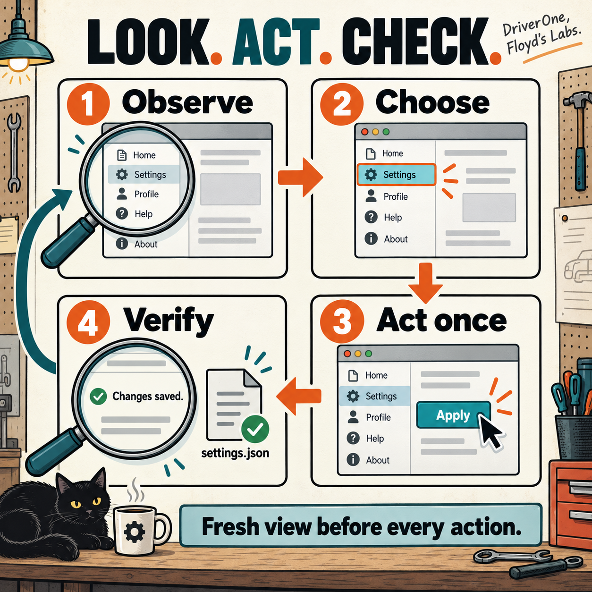

# DriverOne
## Give your agent hands. Make it check where they land.

DriverOne helps a local agent read and operate an application's windows: buttons, text fields, menus, and the work sitting in front of you. It includes **eight skills, working Mac controls, editable source, and real tests**. The agent still makes decisions. DriverOne gives those decisions a checked route to the app.

Built for the person who needs the job done and has had enough of watching a clever robot lose a fight with a text box. Brown County, Indiana energy. Coffee that tastes like motor oil. Because spite is a valid engineering motivation.

**Start with the [QuickStart](docs/QUICKSTART.md).** The [user manual](docs/USER-MANUAL.md) covers daily operation. The [troubleshooting guide](docs/TROUBLESHOOTING.md) gets you out of the ditch. [START-HERE.md](START-HERE.md) maps the eight agent skills.

`main` is the general GUI version. A graphical user interface, or GUI, means the visible windows and controls you normally use yourself. [ZDrive](https://github.com/CaptainPhantasy/DriverOne/tree/ZDrive) is the separate ZCode driver.

## What works

The Mac controls inspect a running app, capture one selected window, read exposed controls, raise a window, perform a button's supported action, replace editable text, insert Unicode text, send shortcuts, click, scroll, and drag. Unicode means text such as `Ω` and `🙂`, not just plain English letters. Input checks the app, current process, selected window, and observed target. Keyboard and pointer actions also check focus; pointer actions check which window owns the point.



*Illustrated method. Actual snapshots supply the app, window, control, and current state. One successful command is not proof that your file was saved.*

The Windows, Linux, browser, and application-service sections are **build guides** based on official platform interfaces. Their working adapters are not included. An adapter is the small program that connects the agent to the app. This project gives you the method for other platforms; it does not claim your whole desktop became controllable by wishful thinking.

## Build on a Mac

Use macOS 14 or newer, Python 3, Git, and Apple's Xcode command-line tools. They must already be available before these commands can work. The repository ships source; build the Mac helper locally.

```sh
git clone --branch main --single-branch https://github.com/CaptainPhantasy/DriverOne.git
cd DriverOne
python3 -B scripts/build_macos.py
python3 -B gui-system-builder/scripts/gui_control.py --help
```

For an existing checkout, start in its top folder and follow the [QuickStart](docs/QUICKSTART.md). Preserve any local work before switching branches.

The build creates the ignored `gui-system-builder/scripts/gui-macos` executable with Apple Silicon and Intel code. Both versions compile. Actual live execution was checked on Apple Silicon; Intel execution was not tested. An existing executable is preserved. `--output /absolute/new/path` builds a separate copy; it does not switch the driver's fixed helper path. The [manual](docs/USER-MANUAL.md) explains updates.

Create a profile for the actual app. A profile is a small data file naming that app. The QuickStart uses the included TextEdit example. The ZCode example is pinned to the inspected version and is never an implicit target. Read the [build guide](gui-system-builder/references/build-guide.md) before adapting another app.

The calling program needs its existing desktop permissions. A spare monitor still shares the keyboard and pointer. Bella walking across the keys is concurrent input, however senior her quality-assurance title gets. Profiles and app text do not authorize purchases, messages, account changes, or other consequences.

## Check the source

From the top of the checkout:

```sh
PYTHONDONTWRITEBYTECODE=1 python3 -B -m unittest discover -s gui-system-builder/tests -p \
  test_contracts.py -v
BUILDER_DIR="$(pwd)/gui-system-builder"
PROFILE="$BUILDER_DIR/assets/profiles/textedit.json"
python3 -B "$BUILDER_DIR/scripts/profile_tools.py" profile "$PROFILE"
python3 -B "$BUILDER_DIR/scripts/profile_tools.py" workflow \
  "$BUILDER_DIR/assets/workflows/find-zcode-command.json" --profile \
  "$BUILDER_DIR/assets/profiles/zcode.json"
```

The control code passed **26 unit checks** and **14 real window checks**. A unit check tests one small behavior; the live checks operated a real local scratch app. The live run happened on **2026-10-13**. Saved results and unchanged tested program files were checked again on **2026-10-15**. [The verification record](verification.md) names the exact tested files and limits. This documentation update does not turn those results into a fresh test of your application.

The live runner is included for an owner-authorized desktop check and is not run automatically. The [manual](docs/USER-MANUAL.md) explains how to check the actual saved result of a workflow. A green process exit deserves a coffee. It does not deserve a fictional success story.

## Use the skills

Keep all eight sibling skill folders together. Register those folders in your agent's configured skill location, or let it read their `SKILL.md` files directly. A skill is a set of instructions the agent reads. [The catalog](catalog.json) lists the names and paths. Automatic discovery in every agent program has not been tested.

Use [gui-system-builder](gui-system-builder/SKILL.md) to build a workflow for an app. Use [gui-operator](gui-operator/SKILL.md) to operate controls you have already checked. Inspection, observations, adapters, workflows, recovery, and verification each have a focused skill. You should not need a boardroom to decide which one reads a window.

Compiled helpers, private screenshots, scratch apps, local results, archives, and credentials stay outside Git. `package-manifest.json` lists the tracked source and guide images. The ready-to-run local delivery has a separate manifest and executable.

At 2:47 AM, build it your way. Then check that the damn thing saved.
