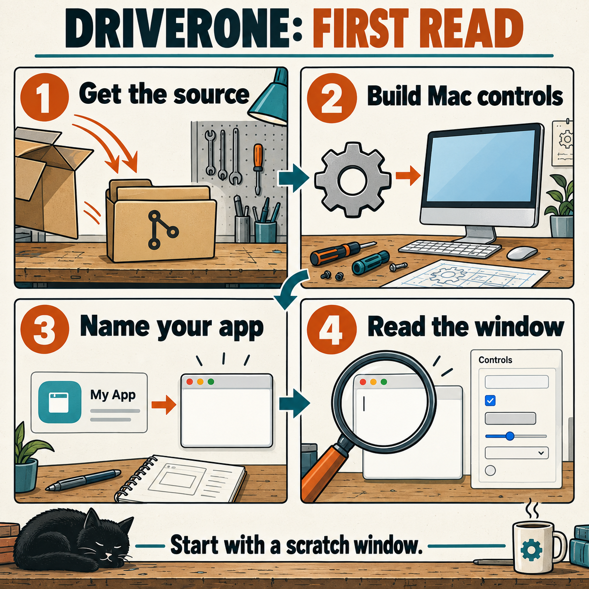

# DriverOne QuickStart
## Get the window talking before you hand it the keys

DriverOne gives your agent a way to read and operate a Mac app's windows. A graphical user interface, or GUI, means the buttons, fields, menus, and windows you normally use yourself. Start with one scratch window. The garage can wait five minutes for the robot to learn which damn button it is looking at.

This guide uses the real controls included on `main`. The TextEdit example is a starter exercise, not a claim that your document has already been edited or saved. Windows, Linux, and browser controls still need to be built from the supplied guides. The ZCode-specific version lives on [ZDrive](https://github.com/CaptainPhantasy/DriverOne/tree/ZDrive).



*Illustrated setup. The commands below do the work. Your actual app state supplies the targets.*

## 1. Get the source

You need a Mac running macOS 14 or newer, Python 3, Git, and Apple's Xcode command-line tools. Git is the program that copies and tracks this repository. The Xcode tools include the compiler that turns the supplied Mac source into a runnable program. Use a local agent or terminal on the same Mac as the app.

Check what is already installed:

```sh
sw_vers -productVersion
python3 --version
git --version
xcrun --find swiftc
```

If a check fails, use [troubleshooting](TROUBLESHOOTING.md) before continuing. These checks do not install anything or grant access.

For a new copy:

```sh
git clone --branch main --single-branch https://github.com/CaptainPhantasy/DriverOne.git
cd DriverOne
```

Already have a copy? Open that folder and check `git branch --show-current`. Use a clean `main` checkout. Preserve any existing work before switching branches. Do not clone on top of an existing `DriverOne` folder.

## 2. Build the Mac controls

From the repository's top folder:

```sh
python3 -B scripts/build_macos.py
```

This creates `gui-system-builder/scripts/gui-macos` for both Apple Silicon and Intel Macs. The source repository does not include that compiled file. Both versions were compiled; live execution was checked on Apple Silicon.

If the build says the output already exists, it has preserved the existing file. For normal use, keep the existing verified helper. To build a separate comparison copy, use `--output` with a new absolute filename in an existing folder. That option does not change which helper the driver uses. See [the manual](USER-MANUAL.md#build-and-update-without-trampling-your-work).

## 3. Name the app

A profile is a small text file that tells DriverOne exactly which app to use. The supplied TextEdit profile names `/System/Applications/TextEdit.app`, with the app identifier `com.apple.TextEdit`. It does not pin a version. Recheck the installation before using it.

Set these names in the same terminal session, from the top of your checkout:

```sh
BUILDER_DIR="$(pwd)/gui-system-builder"
PROFILE="$BUILDER_DIR/assets/profiles/textedit.json"
OBS_DIR="$(mktemp -d "${TMPDIR:-/tmp}/driverone-first-read.XXXXXX")"
```

`BUILDER_DIR` points to the shared tools. `PROFILE` names the exact app record. `OBS_DIR` is a fresh local folder for observations. Keep it private; a screenshot can contain your app's text.

Validate the profile and check that the local controls exist:

```sh
python3 -B "$BUILDER_DIR/scripts/profile_tools.py" profile "$PROFILE"
python3 -B "$BUILDER_DIR/scripts/gui_control.py" --profile "$PROFILE" doctor
```

The profile check should report `"ok": true`. In the doctor result, look for `"backend_available": true`. Doctor can return `"ok": true` while that second value is false. It checks whether the included controls are present, not whether an app workflow works.

## 4. Read one scratch window

Open TextEdit yourself. Create a blank scratch document and leave it visible. Keep other TextEdit windows out of the way so you can identify the intended one. If TextEdit is showing a file picker, finish or cancel it yourself before this first read.

The program calling DriverOne needs the Mac's existing Accessibility permission to read and operate controls. That is the Mac feature that exposes button names and text fields. Screenshots also need existing Screen Recording permission. DriverOne reports missing access; it does not grant it. A restricted agent environment may block desktop access separately.

Read the running app:

```sh
python3 -B "$BUILDER_DIR/scripts/gui_control.py" --profile "$PROFILE" info
```

Check the returned `bundle_id`, `app_path`, version, and window list. Inspect `accessibility_trusted`, `screen_capture_available`, and `input_posting_available` too; a successful information read does not make a false permission flag true. Match the window to the scratch document you opened. Now save a view of it:

```sh
python3 -B "$BUILDER_DIR/scripts/gui_control.py" --profile "$PROFILE" snapshot --screenshot \
  --output-dir "$OBS_DIR"
```

Read the returned `snapshot_file` and `screenshot_file`. Open the exact image path in an image viewer. Read the saved text file to find the controls. `nodes` lists them; `truncated` tells you whether the view was cut short. The image and control list must describe the intended window. If the default chose another window, use the observed window number with `snapshot --window-id` as shown in [the manual](USER-MANUAL.md#choose-the-window-before-the-control).

A successful first read means the app identity, intended window, current controls, and image agree. It does not mean a document was saved or any text was entered. That distinction is why Bowser is allowed near the router and Bella is kept off the keyboard.

## 5. Give the agent a bounded first job

Keep all eight skill folders together. Let your agent read [gui-system-builder](../gui-system-builder/SKILL.md) to build a new app workflow, or [gui-operator](../gui-operator/SKILL.md) to operate controls you have already checked. If its skill loader only sees immediate child folders, register the eight sibling folders together. [The catalog](../catalog.json) names them. A skill folder existing on disk does not prove your agent has loaded it.

Here is an example instruction for the first job:

> Read `START-HERE.md`, then `gui-operator/SKILL.md`. Use the TextEdit profile in this checkout. Inspect my blank scratch document. Show me its app identity, selected window, and exposed text field. Stop after the read.

That is a read-only example. For an input exercise, explicitly name the scratch document, the exact text, and whether it should be saved or restored. The [user manual](USER-MANUAL.md) explains one action at a time, fresh targets, and checking the actual saved result. Do not turn a first run into a subscription treadmill of accidental clicks.

If something refuses to move, use [troubleshooting](TROUBLESHOOTING.md). A refusal can be the tool keeping your real work out of the ditch. Because spite is a valid engineering motivation; guessing which window owns the cursor is not a useful engineering method.

Back to [DriverOne](../README.md) or [the skill guide](../START-HERE.md).
