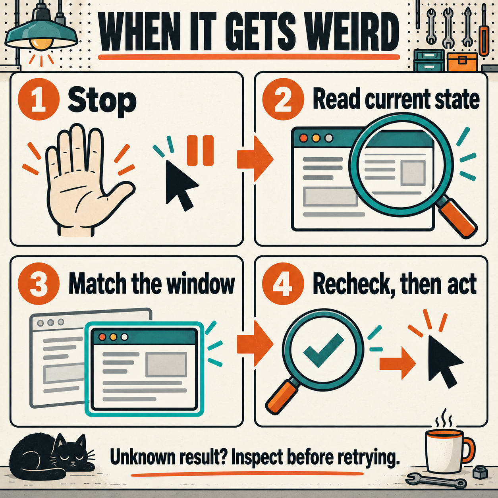

# Troubleshooting DriverOne

A refusal is useful information. The driver is telling you which part it could not prove. Find that part, fix the smallest thing, and take a fresh look. Brown County garage rule: more coffee is allowed; blind clicking is not.

Start with [Quickstart](QUICKSTART.md). Keep the [User Manual](USER-MANUAL.md) open for the full command reference, or return to [DriverOne](../README.md).



*Keep the evidence. Fix the cause. Check the result before another action.*

## First: did nothing happen, or do you just not know?

Read the whole error. Some refusals happen before input. Others happen after part of an action. `ACTION_OUTCOME_UNKNOWN`, a timeout, an invalid adapter reply, and a lost connection do **not** prove that the app ignored the request.

Before repeating a save, send, submission, or record creation, inspect its destination. Look for the existing file, task, message, or record. Match its identity and content. If it exists, continue from there. If it is still running, observe that same operation. If the result is unclear and repetition could create a duplicate, stop that action until the uncertainty is resolved. A second click is not a diagnostic tool.

## Get a useful diagnosis

Run these from the repository's top folder. They read local records and app information; they do not send mouse or keyboard input. The supplied TextEdit starter profile names the built-in app without pinning a version. Open a visible scratch document as described in Quickstart. For another app, set `PROFILE` to your own validated, absolute profile path.

```sh
REPO_DIR="$(pwd -P)"
BUILDER_DIR="$REPO_DIR/gui-system-builder"
PROFILE="$BUILDER_DIR/assets/profiles/textedit.json"
OBS_DIR="${TMPDIR:-/tmp}/driverone-observations"

python3 --version
python3 -B "$BUILDER_DIR/scripts/profile_tools.py" profile "$PROFILE"
python3 -B "$BUILDER_DIR/scripts/gui_control.py" --profile "$PROFILE" doctor
python3 -B "$BUILDER_DIR/scripts/gui_control.py" --profile "$PROFILE" info
```

`doctor` checks whether the included helper is present and marked as executable for this Mac profile. It does not run the helper or prove its processor format is compatible. Its `backend_available` field is not a live app test. `info` reads the running app, its process number, window list, version, and existing desktop permissions. A process number identifies a running copy; the driver also checks when that copy started.

To observe the app after that diagnosis, this command saves local files. It does not click or type:

```sh
python3 -B "$BUILDER_DIR/scripts/gui_control.py" --profile "$PROFILE" snapshot --screenshot \
  --output-dir "$OBS_DIR"
```

Open the exact `snapshot_file` and `screenshot_file` returned by that call. Keep them private and outside Git. JSON is the structured text the driver returns. Any `WINDOW_ID` or `TARGET_PID` used below must come from your current observation; those names do not supply real target numbers by themselves.

## The helper is missing, or the build stops

**“Packaged native helper is missing or not executable.”** The repository contains source. Check `doctor`, then inspect the expected local file:

```sh
ls -l "$BUILDER_DIR/scripts/gui-macos"
xcode-select -p
/usr/bin/xcrun --find swiftc
```

If the helper is absent and the compiler is already installed, build it:

```sh
python3 -B "$REPO_DIR/scripts/build_macos.py"
```

The build needs macOS 14 or newer, Python 3, and Apple's Xcode command-line tools. See [the manual's build and update instructions](USER-MANUAL.md#build-and-update-without-trampling-your-work). It compiles Apple Silicon and Intel code. Full Xcode is not required just because `xcodebuild -version` complains about a command-line-tools installation. If Python or `swiftc` is missing, name that missing tool. Arrange its installation through the owner's normal process; this driver does not download it.

**“Output already exists; preserve it and choose a new --output path.”** This is intentional. Keep a working helper. For a comparison build, create a new temporary folder and build there:

```sh
BUILD_CHECK_DIR="$(mktemp -d "${TMPDIR:-/tmp}/driverone-build-check.XXXXXX")"
python3 -B "$REPO_DIR/scripts/build_macos.py" --output "$BUILD_CHECK_DIR/gui-macos"
```

That alternate file does not change the Python driver's fixed helper path. An intended replacement needs the previous executable preserved first, then a build at the default location and a new app check. Do not delete the old file to silence the error. **“The output directory must already exist.”** means choose an existing parent folder, as the example above does.

**“This included adapter runs on macOS.”** A Windows, Linux, or browser profile can be valid data while having no included working driver. Use the [platform build guide](../gui-adapter-engineer/references/platform-adapters.md) to build and test that adapter. Changing the profile's platform label does not make Mac controls work elsewhere.

## The profile or path is wrong

**“Use an absolute existing record file”**, **“Snapshot directory must be absolute.”**, or **“Use an absolute existing snapshot file.”** means the named file or folder is not the required absolute path. Use the path returned by the latest command, not an example filename.

```sh
python3 -B -m json.tool "$PROFILE"
python3 -B "$BUILDER_DIR/scripts/profile_tools.py" profile "$PROFILE"
```

The record checker also refuses duplicate JSON keys, unsupported fields, wrong schema versions, missing required fields, and invalid app identifiers. Fix the named data error. Profiles identify targets; they cannot contain a shell command, helper path, or permission grant. For workflow records, validate the pairing too:

```sh
ZCODE_PROFILE="$BUILDER_DIR/assets/profiles/zcode.json"
python3 -B "$BUILDER_DIR/scripts/profile_tools.py" workflow \
  "$BUILDER_DIR/assets/workflows/find-zcode-command.json" --profile "$ZCODE_PROFILE"
```

This separate example pairs the supplied ZCode workflow with its matching ZCode profile, not the TextEdit starter. For your app, substitute both actual absolute record paths. Validation checks the records. It does not run the workflow.

**“Duplicate target selector: --profile”** or **“Duplicate target selector: --pid”** means there is more than one target choice in the command. Keep the intended one. Abbreviated flags are refused; write `--profile`, `--snapshot`, and other flags in full.

## The app, installed copy, or version does not match

**`APP_NOT_RUNNING`** means the helper did not find exactly one running copy matching the app identifier and optional process number. It can mean no match or an ambiguous match. Read the reported count. Check which copy is running; the driver does not launch one automatically.

**`APP_PATH_MISMATCH`**, **“Running app path differs from the profile.”**, or **“App version differs from the inspected profile.”** means selection or inspection is stale. The build pin can fail separately with **“App build differs from the inspected profile.”** Confirm the actual app, location, and version. For the supplied ZCode example only, these commands read the installed app's information:

```sh
/usr/libexec/PlistBuddy -c 'Print :CFBundleIdentifier' \
  /Applications/ZCode.app/Contents/Info.plist
/usr/libexec/PlistBuddy -c 'Print :CFBundleShortVersionString' \
  /Applications/ZCode.app/Contents/Info.plist
/usr/libexec/PlistBuddy -c 'Print :CFBundleVersion' \
  /Applications/ZCode.app/Contents/Info.plist
```

Reinspect the changed app and affected controls before updating your profile. Do not quietly remove a version pin to force a pass. If you supplied `--pid`, check that observed process number rather than recycling a number from an earlier run:

```sh
ps -p "$TARGET_PID" -o pid=,comm=
```

Set `TARGET_PID` to the real observed process number first. A restarted app invalidates old observations even if the operating system later reuses a number. **`APP_IDENTITY_UNAVAILABLE`** means the helper could not establish the app's path or start time. Preserve the refusal and inspect the running copy; input is not justified without that identity.

## Permissions and a sandbox are separate problems

**`ACCESSIBILITY_UNAVAILABLE`** concerns permission to read and operate controls. **`SCREEN_CAPTURE_UNAVAILABLE`** concerns screenshots. **`INPUT_POSTING_UNAVAILABLE`** concerns native mouse and keyboard events. Inspect `accessibility_trusted`, `screen_capture_available`, and `input_posting_available` in `info`.

Access can differ between a terminal, an agent program, and a helper launched by either. A sandbox is a separate restriction imposed by the calling program. Existing Mac permission does not cancel that restriction. A permission denial is not proof that the app lacks controls or that the whole computer is unreachable.

Use the calling program's authorized access route, or have the owner enable the exact missing Mac permission for the intended caller. Do not disable protections, scrape credentials, or restart the desktop to manufacture access. The helper does not request or grant privacy permissions itself. If a profile mismatch blocks `info`, resolve that target mismatch first; it is a different failed layer.

## The window is empty, tiny, or the wrong one

For Electron apps that expose few controls, `--enhance` asks the running app to expose more of its control tree. Electron is the desktop app framework used by ZCode. This is an app request, not a system permission grant:

```sh
ZCODE_PROFILE="$BUILDER_DIR/assets/profiles/zcode.json"
python3 -B "$BUILDER_DIR/scripts/gui_control.py" --profile "$ZCODE_PROFILE" snapshot \
  --enhance --screenshot --output-dir "$OBS_DIR"
```

This command is the ZCode alternative, with its own profile pinned to the inspected installation. TextEdit does not need it. Use it only when the inspected app profile enables `electron_accessibility`. Otherwise the wrapper returns **“Electron accessibility exposure is not enabled in this app profile.”** Do not turn it on for an unrelated app just to remove that message.

By default, the helper chooses a large ordinary window and excludes tiny overlays. **`MAIN_WINDOW_UNAVAILABLE`** can mean the app has no accessible window at least 200 by 150 points. **`WINDOW_ID_UNAVAILABLE`** means an accessible window could not be matched to exactly one native window.

Read `info` again. See [choosing the window before the control](USER-MANUAL.md#choose-the-window-before-the-control). For a small dialog, use an actual visible app-owned `window_id` from that output. Set `WINDOW_ID` to that observed number; never guess it:

```sh
python3 -B "$BUILDER_DIR/scripts/gui_control.py" --profile "$PROFILE" info
python3 -B "$BUILDER_DIR/scripts/gui_control.py" --profile "$PROFILE" snapshot --window-id \
  "$WINDOW_ID" --screenshot --output-dir "$OBS_DIR"
```

Explicit selection supports small ordinary windows down to one point in each dimension. **`SELECTED_WINDOW_UNAVAILABLE`** means that exact choice is not currently visible, does not belong to the selected app, or cannot be uniquely matched. A system dialog owned by a different app needs its own correct profile and authority. Do not point this profile at somebody else's window.

## Focus, covering windows, displays, and human hands

**`APP_NOT_FRONTMOST`** means another app is active. **`SELECTED_WINDOW_NOT_FOCUSED`** means the app is active but the exact selected window is not focused. A sibling dialog counts as a different window.

Read `info` and capture the intended window. If raising that observed window is within the task, `activate --window-id` is the corrective command. It changes focus, so take a new snapshot afterward:

```sh
python3 -B "$BUILDER_DIR/scripts/gui_control.py" --profile "$PROFILE" activate --window-id \
  "$WINDOW_ID"
python3 -B "$BUILDER_DIR/scripts/gui_control.py" --profile "$PROFILE" snapshot --window-id \
  "$WINDOW_ID" --screenshot --output-dir "$OBS_DIR"
```

**`WINDOW_OCCLUDED`** means the real point belongs to another app or another window. Inspect the covering dialog or raise the intended window. **`POINT_OWNERSHIP_UNAVAILABLE`** and **`POINT_WINDOW_UNAVAILABLE`** mean the operating system could not prove the point's owner. Retain the check. Do not strip it out because a screenshot looks plausible.

**`POINT_OUTSIDE_DISPLAY`**, **`DISPLAY_GEOMETRY_UNAVAILABLE`**, **`WINDOW_NOT_VISIBLE`**, and **`ACTIVATION_NOT_VERIFIED`** require a fresh look at the actual desktop. An off-screen window can still be captured. Place the intended window on an active display through an authorized window operation, then observe again. A saved image alone does not prove the pointer can reach it.

A spare monitor still shares the computer's keyboard and pointer. Coordinate input with the person using the Mac. **`MODIFIER_STATE_CONFLICT`** means a held Command, Control, Option, or Shift key would interfere. Wait for the human to release it; do not release their keys for them. **`SCROLL_POINTER_CHANGED`** or **`SCROLL_POINTER_NOT_VERIFIED`** means pointer movement interfered with the wheel check. A pointer move may already have occurred, even though no wheel event was sent. Inspect before retrying. Bella gets one keyboard cameo here, not control of your Save button.

## The snapshot expired or the target changed

**`SNAPSHOT_EXPIRED`** means the saved observation is older than 120 seconds or has an invalid time. **`SNAPSHOT_STALE`** means the app, process start time, window, control, value, bounds, or profile binding changed. **`INVALID_SNAPSHOT`** can mean an unsupported snapshot format or a different profile fingerprint. A fingerprint is a content checksum; it ties the observation to the profile data.

Take a fresh snapshot and select the target again from its current label, role, nearby content, and window. Do not edit a saved timestamp, control path, or fingerprint to make it pass. Editing the profile also requires new observations. Two identical-looking controls can still belong to different records, so check their surrounding context before a consequential action.

## Text will not change

**`SECURE_VALUE_REJECTED`** and **`SECURE_FOCUS_REJECTED`** protect password fields. Their snapshot values are redacted. This generic driver does not read or write them.

**`READ_ONLY_VALUE_REJECTED`**, **`ELEMENT_DISABLED`**, **`UNSUPPORTED_VALUE_ROLE`**, or **`VALUE_NOT_SETTABLE`** means direct replacement is unavailable for that current control. Read the fresh node's role, `enabled`, `value_settable`, and exposed actions. Find the app's real edit mode or supported editable control. Do not bypass a read-only field with keyboard input.

`set-value` replaces the whole supported field, including with empty text. `type` inserts at the current selection. Highlighted text is replaced, including the whole field if all its text is selected; check the selection first. It requires the exact observed editable field to be focused. **`TEXT_TARGET_NOT_FOCUSED`** means that condition was absent. **`UNSUPPORTED_TEXT_TARGET`** means the field is not an enabled, editable text target. Focus it through an authorized observed action, take a new snapshot, and verify `focused_id` before typing.

**`TEXT_TARGET_CHANGED`** may be reported after some text was posted. Inspect the settled text before any retry. Compare exact Unicode characters and line breaks. `type` accepts up to 65,536 UTF-8 bytes; `set-value` accepts up to 1,048,576. UTF-8 is the text encoding used by the driver. **`INVALID_VALUE`** also covers invalid text or a zero byte. A byte is one unit of stored data; some characters use several. Do not assume Enter only adds a line: the app may submit the field.

## A click lands in the wrong place, or the tree is incomplete

**`POINT_OUTSIDE_WINDOW`** means the requested coordinates are outside the selected window. DriverOne expects logical **window points**, not image pixels or absolute screen positions. Convert a point measured in the current image with the saved image size and window bounds:

```text
window_x = image_x × window_width / image_pixel_width
window_y = image_y × window_height / image_pixel_height
```

Do not add the screen origin; the helper does that. Do not assume a scale of one or two. Use the current `screenshot_geometry` and capture again after the window moves or resizes. Scrolling and dragging still need a later check of actual content, not merely pointer movement. Equal opposite wheel counts do not prove exact restoration.

If the saved snapshot says `truncated: true` or a node says `value_truncated: true`, you have an incomplete observation. The defaults are 50 levels, 4,000 nodes, and 160 characters per value in the Python driver. Increase only the needed limits, within the supported maximums of 80 levels, 20,000 nodes, and 4,096 characters:

```sh
python3 -B "$BUILDER_DIR/scripts/gui_control.py" --profile "$PROFILE" snapshot --max-depth \
  60 --max-nodes 8000 --max-value-chars 1024 --screenshot --output-dir "$OBS_DIR"
```

A complete control tree still does not include every hidden, filtered, archived, collapsed, or unloaded record. Inspect the relevant view. For a canvas without exposed controls, use a current window image and a verified coordinate conversion; an empty tree is not permission to guess.

## Screenshots fail or the command times out

**`CAPTURE_TIMEOUT`** means the exact-window capture child exceeded its ten-second deadline. The helper asks only its own capture child to stop. It does not accept partial output and does not fall back to the whole display or clipboard.

**`CAPTURE_WINDOW_CHANGED`**, **`CAPTURE_WINDOW_UNAVAILABLE`**, or **`CAPTURE_GEOMETRY_CHANGED`** means the selected process, window, or bounds changed or could not be verified. Observe the current window before a new capture. **`CAPTURE_OUTPUT_FAILED`**, **`CAPTURE_FORMAT_INVALID`**, **`CAPTURE_SIZE_MISMATCH`**, **`CAPTURE_LAUNCH_FAILED`**, and **`CAPTURE_PROCESS_FAILED`** identify output, image, launch, or child-process failure. A reserved or nonempty file is not automatically an accepted image. Check the returned error, output-directory access, app identity, window visibility, and screenshot permission. Preserve the failed files privately if needed for diagnosis.

For another local directory diagnosis, these commands only inspect the current choice:

```sh
ls -ld "$OBS_DIR"
python3 -B "$BUILDER_DIR/scripts/gui_control.py" --profile "$PROFILE" info
```

If the directory has not been created yet, its absence is expected; a successful snapshot creates it. Choose an authorized absolute output directory where the caller can write.

The Python driver separately waits up to 30 seconds for each helper call. **“Outcome unknown: command timed out. Inspect current app state before retrying.”** describes that outer deadline. It is not the same as the ten-second capture limit, and it does not prove that an app operation stopped. **`ACTION_OUTCOME_UNKNOWN`** means an app action, field write, or window raise was requested but its acknowledgment failed. Read the current state and reconcile any saved result before repeating. Do not keep rerunning the same request while the evidence stays unchanged.

## The command succeeded, but the job is not finished

An action result can say `ok: true` and `verified: false`. That means the request was made; the app's result still needs checking. Inspect the exact document, record, destination, account, or task afterward. Read saved file content when a save is the goal. A button press does not prove persistence. A model name does not prove a live response. A connected reader does not prove account sign-in, a paid model task, a sent message, or a production change.

The recorded runtime passed **26 unit checks** and **14 real window checks**. The live window run was on **2026-10-13**; its unchanged program files and saved evidence were checked again on **2026-10-15**. Those tests establish the named checks in [the verification record](../verification.md). They do not guarantee a new app's whole workflow or another agent program's access.

When a boundary remains, report the exact failed layer, the observed error, what changed already, and the smallest missing permission, fact, or resource. Preserve completed work. Restore a temporary field only while it still contains your own temporary value; leave a newer human edit alone. That's the useful kind of stubborn. Because spite is a valid engineering motivation; guessing is not a recovery method.
